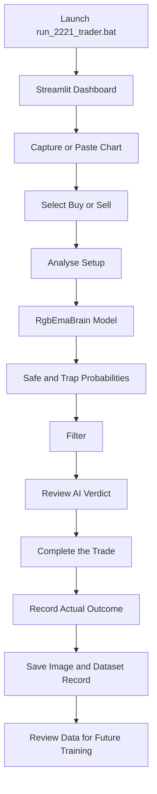

# Decision Engine - EMA cross over🎯

**An AI-powered, image-based trading decision-support system built with PyTorch and Streamlit.**

project combines chart-image analysis with trade-direction information to classify trading setups as **Safe** or **Trap**. Its dashboard lets users capture charts, review model predictions, and record actual trade outcomes for future model development.

---

## 📌 Table of Contents

* [Project Overview](#-project-overview)
* [Tech Stack](#-tech-stack)
* [Model Architecture](#-model-architecture)
* [Training Pipeline](#-training-pipeline)
* [Dataset Structure](#-dataset-structure)
* [Dashboard Features](#-dashboard-features)
* [How It Works](#-how-it-works)
* [Live Trading Results](#-live-trading-results)
* [Project Structure](#-project-structure)
* [Installation and Execution](#-installation-and-execution)
* [Documentation](#-documentation)
* [Limitations and Risk Disclaimer](#-limitations-and-risk-disclaimer)

---

## 🧠 Project Overview


The system combines two types of information:

1. **Computer Vision:** Analyses chart images and learns visual patterns.
2. **Trade Context:** Uses the selected Buy or Sell direction.

The model combines these inputs to estimate whether a setup belongs to the **Safe** or **Trap** class.

The Streamlit dashboard provides an interface for chart capture, analysis, and recording real trade outcomes.

**Core workflow:**

`Capture Chart → Analyse Setup → Review Prediction → Record Outcome → Improve Dataset`

---

## 🛠️ Tech Stack

### Training and Deep Learning

| Technology   | Purpose                                                 |
| ------------ | ------------------------------------------------------- |
| PyTorch      | Model development and training                          |
| Torchvision  | ResNet18, image transformations, and pretrained weights |
| ResNet18     | Foundational computer-vision architecture               |
| Scikit-learn | Training and validation data splitting                  |
| Pandas       | Dataset processing                                      |
| Pillow (PIL) | Image loading and processing                            |

### Dashboard and Automation

| Technology       | Purpose                                                |
| ---------------- | ------------------------------------------------------ |
| Streamlit        | Interactive trading dashboard                          |
| PyWin32          | Windows window management and chart-capture automation |
| Pillow ImageGrab | Clipboard image reading                                |

---

## 🏗️ Model Architecture

### 1. Vision Pathway

* Uses a modified, pretrained ResNet18.
* Starts with ImageNet V1 pretrained weights.
* Freezes early layers to retain foundational visual features.
* Fine-tunes the final convolutional block (`layer4`) and fully connected (`fc`) layers.
* Produces a 128-dimensional feature representation.

This pathway learns visual patterns from chart screenshots, including relevant candle structures and EMA colour patterns.

### 2. Context Pathway

The model receives the selected trade direction as a binary input:

| Direction | Input |
| --------- | ----: |
| Buy       |   1.0 |
| Sell      |   0.0 |

A linear layer converts this input into 16 context features.

### 3. Feature Fusion

The model combines both pathways:

* Vision features: 128
* Context features: 16
* Combined features: 144

A fusion network processes these features using:

`Linear → ReLU → Dropout → Linear`

The final layer produces two class outputs:

* **Trap (0)**
* **Safe (1)**

The dashboard converts the model outputs into the probabilities and verdicts displayed to the user.

---

## 🎓 Training Pipeline

The training pipeline uses the labelled chart-image dataset to learn the difference between Safe and Trap setups.

### Data Split

* 80% training data
* 20% validation data

Scikit-learn is used for splitting the dataset.

### Image Augmentation

The training pipeline uses:

* Random Resized Cropping
* Colour Jittering
* Brightness and contrast adjustments

These transformations introduce image variation while aiming to preserve useful chart patterns.

### Class Imbalance Handling

The training script calculates class weights and applies them through `CrossEntropyLoss`.

This helps address an imbalance between Safe and Trap examples.

### Optimisation

| Setting           | Configuration            |
| ----------------- | ------------------------ |
| Optimizer         | Adam                     |
| Regularisation    | Weight decay             |
| Training duration | 25 epochs                |
| Model selection   | Best validation accuracy |
| Saved model       | `rgb_sniper_2221.pth`    |

The training script saves the best-performing checkpoint according to validation accuracy.

**Note:** Validation accuracy alone does not establish profitability or performance on future market conditions.

---

## 📂 Dataset Structure

The dataset uses three columns:

| Column       | Description                        |
| ------------ | ---------------------------------- |
| `Image_Path` | Local path to the chart screenshot |
| `Type`       | Trade direction: `buy` or `sell`   |
| `Result`     | Actual recorded outcome            |

### Outcome Mapping

The training pipeline maps recorded outcomes into two classes:

| Actual Outcome | Class | Label |
| -------------- | ----- | ----: |
| `tp`           | Safe  |     1 |
| `ctc`          | Safe  |     1 |
| `sl`           | Trap  |     0 |

This mapping is the project's training-label definition. It does not mean that every TP or CTC trade was correctly predicted by the model.

### Example

```csv
Image_Path,Type,Result
dataset images/trade_001.png,buy,tp
dataset images/trade_002.png,sell,sl
dataset images/trade_003.png,buy,ctc
```

The image paths must point to valid image files accessible to the application.

---

## 🖥️ Dashboard Features

### 1. Live Chart Capture

Users can provide a chart in two ways:

**Auto-Capture TradingView**

Uses Windows automation to minimise the terminal, capture the chart, and restore the window.

**Paste Chart**

Users copy a chart and paste it into the application using `Ctrl + C` followed by the dashboard's paste workflow.

### 2. Live AI Analysis

The user selects Buy or Sell and clicks **Analyse Setup**.

The model processes the chart and returns its estimated class probabilities.

### 3. Filter

The confidence filter interprets the predicted Safe and Trap probabilities.

| Condition                   | Verdict          | Meaning                            |
| --------------------------- | ---------------- | ---------------------------------- |
| Safe probability ≥ 65%      | 🟢 GOLDEN SETUP  | Model confidence threshold reached |
| Safe > Trap, but Safe < 65% | 🟡 AVERAGE SETUP | Proceed with caution               |
| Trap > Safe                 | 🔴 SKIP TRADE    | Model favours the Trap class       |

These thresholds describe the project's decision rules, not independently validated trading guarantees.

### 4. Trade Outcome Recording

After a trade completes, the user selects its actual outcome:

* TP — Take Profit
* SL — Stop Loss
* CTC — Cost to Cost, as defined by the project

The application saves the chart image locally and records the corresponding trade information in the configured dataset.

This process creates additional labelled examples for later review and training.

**Recording new data does not automatically mean that the model has been retrained.** A training run and validation process are required to produce and evaluate updated model weights.

---

## 🔄 How It Works



The dashboard assists with analysis and record-keeping. Whether the user enters a trade remains a separate trading decision.

---

## 📊 Live Trading Results

The supplied live dataset was analysed to summarise recorded trading outcomes.

**Reporting period:** 5–6 June 2026.

| Metric                | Count | Percentage |
| --------------------- | ----: | ---------: |
| Total recorded trades |   157 |    100.00% |
| Take Profit (TP)      |    58 |     36.94% |
| Stop Loss (SL)        |    69 |     43.95% |
| CTC                   |    30 |     19.11% |

### Buy vs Sell

| Direction |     TP |     SL |    CTC |   Total |
| --------- | -----: | -----: | -----: | ------: |
| Buy       |     31 |     35 |     17 |      83 |
| Sell      |     27 |     34 |     13 |      74 |
| **Total** | **58** | **69** | **30** | **157** |

Among records labelled TP or SL, the TP share was **45.67%**.

This is a summary of recorded outcomes, not the model's verified prediction accuracy.

The supplied dataset does not contain the original prediction and probability for every trade, realised profit and loss, or transaction costs. Consequently, these figures alone cannot establish the model's predictive edge or net trading profitability.

For the complete breakdown and limitations, see [`result.md`](result.md).

---

## 📁 Project Structure

```text
Model_12/
│
├── Abondend/
├── dataset images/
├── live_dataset_images/
│
├── dataset.csv
├── live_dataset.csv
│
├── live_trader_2221.py
├── rgb_sniper_2221.pth
├── run_2221_trader.bat
│
├── README.md
├── working.md
├── result.md
└── .gitignore
```

The exact files present may vary with the current project version.

| File or Folder         | Purpose                                     |
| ---------------------- | ------------------------------------------- |
| `live_trader_2221.py`  | Main application script                     |
| `rgb_sniper_2221.pth`  | Saved model weights                         |
| `run_2221_trader.bat`  | Windows launcher                            |
| `dataset.csv`          | Dataset file                                |
| `live_dataset.csv`     | Live dataset file                           |
| `dataset images/`      | Chart-image storage                         |
| `live_dataset_images/` | Live chart-image storage                    |
| `working.md`           | Step-by-step workflow documentation         |
| `result.md`            | Recorded live-results report                |
| `.gitignore`           | Excludes configured files from Git tracking |

---

## 🚀 Installation and Execution

### Requirements

The project uses Python and the libraries listed in the Tech Stack section.

From Git Bash or PowerShell, navigate to the project directory:

```bash
cd /c/Models/Model_12
```

If these dependencies are not already installed in your environment, install them with:

```bash
python -m pip install torch torchvision streamlit scikit-learn pandas pillow pywin32
```

### Launch the Dashboard

Run the Windows batch file:

```bash
./run_2221_trader.bat
```

Alternatively, double-click `run_2221_trader.bat` in File Explorer.

The application should open its local Streamlit dashboard. Keep the terminal window open while using the application.

### Training

The trained model is stored in:

`rgb_sniper_2221.pth`


---

## 📚 Documentation

* **[Working Guide](working.md):** Understand the complete application workflow.
* **[Live Results](result.md):** Review recorded outcomes and performance limitations.

---