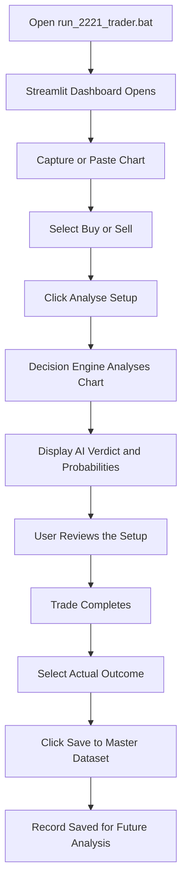
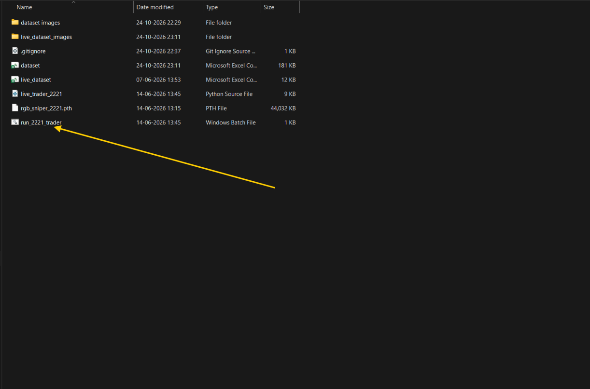
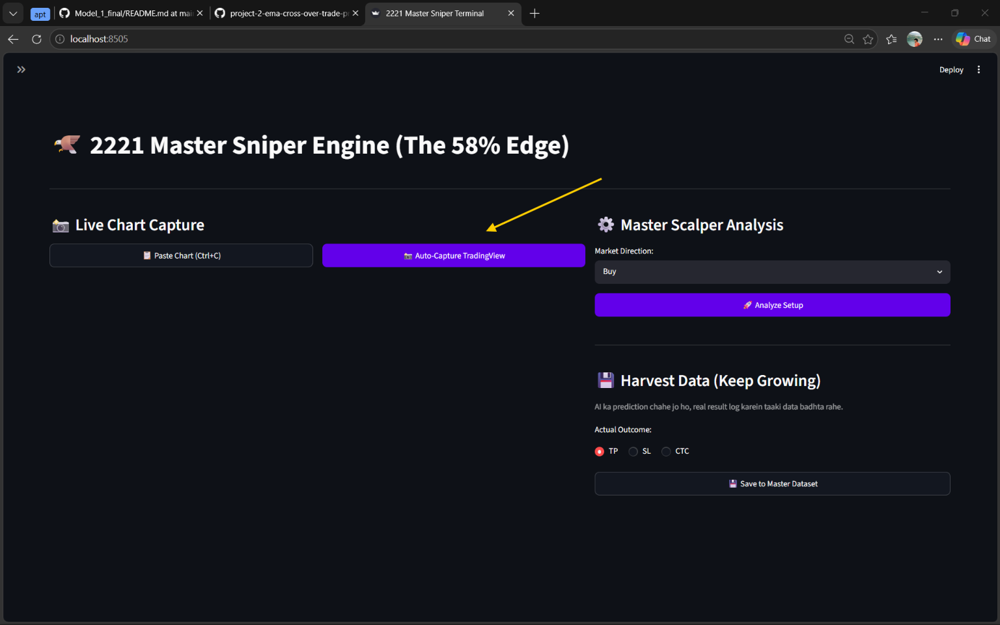
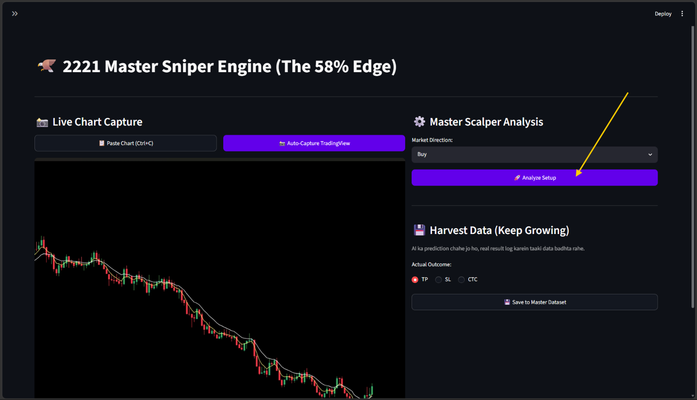
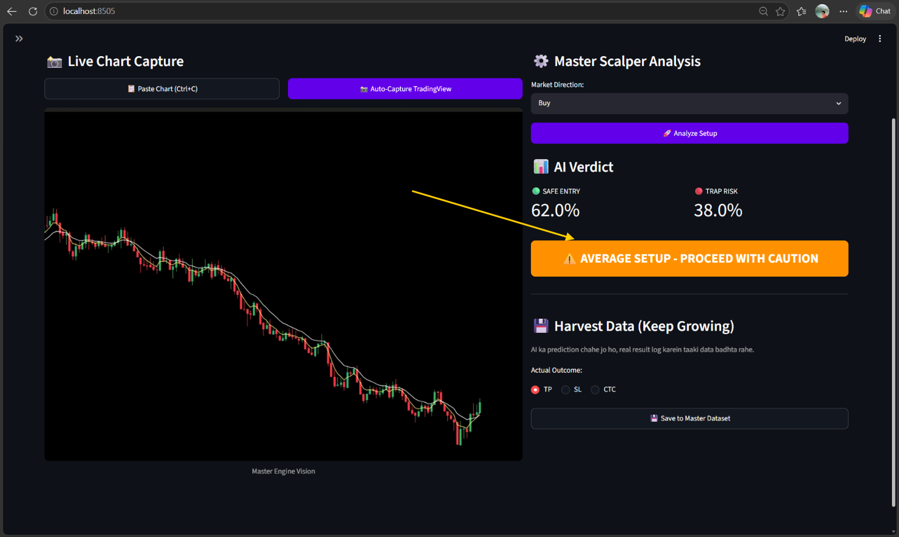
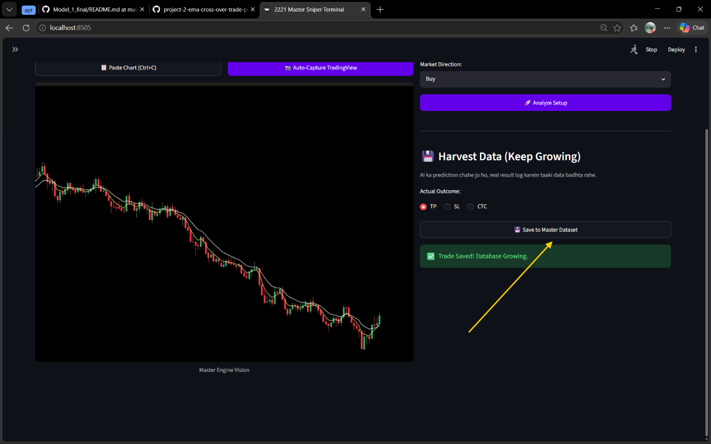

# crossovervision-ai

> **Purpose:** An image-based trading decision-support application that analyses chart screenshots, displays estimated trade probabilities, and records actual trade outcomes for future dataset improvement.

crossovervision-ai provides a simple workflow: capture a chart, analyse the setup, review the AI verdict, and save the completed trade result.

> **Important:** Model probabilities are estimates, not guaranteed outcomes. Always follow your trading plan and risk-management rules.

## Table of Contents

* [How crossovervision-ai Works](#how-crossovervision-ai-works)
* [Step-by-Step Workflow](#step-by-step-workflow)
* [Understanding the AI Verdict](#understanding-the-ai-verdict)
* [The Dataset Feedback Loop](#the-dataset-feedback-loop)
* [Project Files](#project-files)
* [Running the Application](#running-the-application)
* [Screenshots](#screenshots)
* [Important Notes](#important-notes)

## How crossovervision-ai Works

The application helps users review potential trading setups using chart images and a trained model.

## Step-by-Step Workflow

### 1. Start the Application

Open `run_2221_trader.bat` from the project folder.

The application starts its local Streamlit dashboard in your browser.

### 2. Capture the Chart

The dashboard provides two options:

* **Auto-Capture TradingView:** Capture the TradingView chart.
* **Paste Chart (Ctrl+C):** Paste a copied chart into the application.

Check that the correct chart is displayed before continuing.

### 3. Analyse the Setup

Choose the market direction:

* **Buy**
* **Sell**

Click **Analyse Setup** to send the selected chart for analysis.

The decision engine processes the input and displays its prediction.

### 4. Read the AI Verdict

The dashboard displays the estimated probabilities for:

* **Safe Entry:** Estimated probability associated with a favourable setup.
* **Trap Risk:** Estimated probability associated with a risky setup.
* **Setup Verdict:** A summary of the model's assessment.

For example, one supplied screenshot displays:

* Safe Entry: `62.0%`
* Trap Risk: `38.0%`
* Verdict: `AVERAGE SETUP - PROCEED WITH CAUTION`

These values illustrate one particular analysis. They do not establish the model's overall accuracy or guarantee profitability.

Review the output carefully and apply your own trading and risk-management rules before deciding whether to take a trade.

### 5. Save the Actual Trade Outcome

After the trade has completed, select its actual outcome:

* **TP:** Take Profit.
* **SL:** Stop Loss.
* **CTC:** The application's third outcome category; use its documented definition consistently.

Click **Save to Master Dataset**.

The application displays a confirmation when the trade is saved successfully.

Recording actual outcomes creates labelled trade data that can be reviewed for future model development.

## Understanding the AI Verdict

| Item          | Meaning                                                  |
| ------------- | -------------------------------------------------------- |
| Safe Entry    | Estimated probability associated with a favourable setup |
| Trap Risk     | Estimated probability associated with a risky setup      |
| Setup Verdict | Summary of the model's assessment                        |
| TP            | Actual take-profit outcome                               |
| SL            | Actual stop-loss outcome                                 |
| CTC           | The application's third outcome category                 |

The displayed probabilities are model estimates. Their reliability depends on data quality, validation and performance on unseen examples.

## The Dataset Feedback Loop

The application supports a simple learning-data workflow:

1. Capture a chart.
2. Analyse the setup.
3. Review the model's prediction.
4. Record the actual trade outcome.
5. Save the result to the master dataset.
6. Review and validate the collected data before future model training.

**Saving a trade does not automatically prove that the model has learned or improved.** Any retraining and performance evaluation should be treated as a separate process.

## Project Files

| File or Folder         | Purpose                        |
| ---------------------- | ------------------------------ |
| `live_trader_2221.py`  | Main Python application script |
| `rgb_sniper_2221.pth`  | Saved model weights            |
| `run_2221_trader.bat`  | Windows application launcher   |
| `dataset.csv`          | Master dataset                 |
| `live_dataset.csv`     | Live dataset                   |
| `dataset images/`      | Dataset image storage          |
| `live_dataset_images/` | Live image storage             |
| `Abondend/`            | Additional project folder      |
| `screenshots/`         | Documentation screenshots      |
| `working.md`           | Project workflow documentation |

